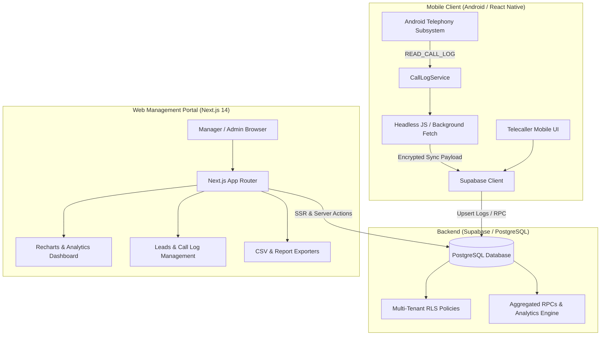

# TeleCallerTracker

> **Enterprise-grade Telecaller Performance Tracking & Lead Management Platform**  
> Combines an Android background call-tracking mobile application with a real-time, multi-tenant Next.js 14 web management portal and Supabase backend.

---

## Architecture Overview



---

## Key Features

### 1. Android Telecaller Client (`com.telecallertracker`)
* **Automated Call Log Sync:** Intercepts incoming, outgoing, and missed call metrics directly from the device telephony API.
* **Background Foreground Service:** Built with persistent Android background tasks (`react-native-background-fetch` and native `BootReceiver.kt`) ensuring tracking persists after device reboot.
* **Telecaller Mobile Dashboard:** Personal KPI metrics (total dials, connected calls, talk time, average duration).
* **Contact Directory & Notes:** In-app contact manager with lead status, disposition tags, and interaction logs.
* **Org Invite Code Onboarding:** Instant onboarding using secure 8-character alphanumeric organisation invite tokens.

### 2. Admin & Manager Web Portal (`portal/`)
* **Real-time KPI Dashboard:** Executive overview of total calls, active telecallers, total duration, and connection rates.
* **Hourly Breakdown Analysis:** Visual call-traffic distribution throughout business hours to pinpoint agent productivity.
* **Call Dispositions & Type Splits:** Interactive pie & bar charts (Incoming, Outgoing, Missed, Rejected).
* **Leads Management:** Centralized lead table with instant status updates, assignments, and search filters.
* **Recordings & Pinned Logs:** High-priority conversation reviews and flagged recordings.
* **Exclusion Numbers Scrubbing:** Global DND and private phone number exclusion filter applied automatically before reports.
* **Template Management:** Pre-configured note and message templates for rapid communication.
* **Granular RBAC:** Role-based access control (`owner`, `admin`, `member`) enforced by database RLS and Next.js middleware.

### 3. Backend & Data Infrastructure (`supabase/`)
* **Multi-tenant Data Isolation:** All tables partitioned by `org_id` with PostgreSQL Row-Level Security.
* **High-Performance RPCs:** Pre-compiled SQL aggregation procedures for sub-millisecond report generation.
* **Automated Rollup Indexes:** Composite indexing across `(org_id, caller_id, called_at DESC)`.

---

## Repository Structure

```
TeleCallerTracker/
├── android/                         # Android native layer
│   ├── app/src/main/
│   │   ├── AndroidManifest.xml      # Telephony permissions & service definitions
│   │   └── java/com/telecallertracker/
│   │       └── BootReceiver.kt      # Auto-start on device reboot
│   ├── build.gradle                 # Native build settings
│   └── local.properties
├── src/                             # React Native Mobile App
│   ├── App.tsx                      # Root mobile container
│   ├── MainTabs.tsx                 # Tab navigation
│   ├── theme.ts                     # Visual design system
│   ├── components/                  # Mobile UI components & skeleton loaders
│   ├── context/                     # Theme & auth state contexts
│   ├── lib/                         # Device haptics & encrypted storage
│   ├── screens/                     # Mobile screens (Calls, Contacts, Dashboard, etc.)
│   └── services/                    # Android call log extraction & Supabase sync
├── portal/                          # Next.js 14 Web Management Portal
│   ├── app/                         # Next.js App Router (auth, dashboard, reports)
│   ├── components/                  # Radix UI + Tailwind dashboard components
│   ├── lib/                         # Supabase SSR clients, queries, utility metrics
│   ├── types/                       # TypeScript database & portal types
│   ├── __tests__/                   # Vitest & Fast-Check property-based tests
│   ├── package.json                 # Web dependencies
│   ├── tailwind.config.ts           # Tailwind CSS configuration
│   └── tsconfig.json                # TypeScript compiler configuration
├── supabase/                        # Database schema & migrations
│   └── schema.sql                   # 40KB Complete SQL schema with RLS & RPCs
├── sql/                             # Specialized SQL migration scripts
├── docs/                            # In-depth architectural & API documentation
│   ├── ARCHITECTURE.md              # System architecture & sync pipeline
│   ├── DATABASE_SCHEMA.md           # Database tables, constraints & RLS policies
│   ├── MOBILE_APP_GUIDE.md          # Mobile app setup & APK build instructions
│   ├── WEB_PORTAL_GUIDE.md          # Web portal architecture & Vercel deployment
│   └── API_REFERENCE.md             # Internal API routes & Supabase RPC docs
└── index.js                         # Headless JS background entry point
```

---

## Quick Start

### 1. Database Setup (Supabase)
1. Create a project at [supabase.com](https://supabase.com).
2. Open the **SQL Editor** in your Supabase dashboard.
3. Paste and run the entire contents of [`supabase/schema.sql`](supabase/schema.sql).
4. Run any supplementary procedures in [`sql/create_missing_rpc_functions.sql`](sql/create_missing_rpc_functions.sql).

### 2. Web Portal Setup
```bash
cd portal

# Copy environment template
cp .env.local.example .env.local

# Fill in your Supabase project keys in .env.local:
# NEXT_PUBLIC_SUPABASE_URL=https://<your-project>.supabase.co
# NEXT_PUBLIC_SUPABASE_ANON_KEY=<your-anon-key>
# SUPABASE_SERVICE_ROLE_KEY=<your-service-role-key>
# CONNECTOR_ENCRYPTION_KEY=<32-byte-hex-key>

# Install dependencies
npm install

# Run development server
npm run dev
```
Open [http://localhost:3000](http://localhost:3000) to access the portal.

### 3. Deploying Portal to Vercel
```bash
cd portal
npx vercel
npx vercel --prod
```

### 4. Mobile Client Setup
```bash
# Install root dependencies
npm install

# Run on connected Android device / emulator
npm run android
```

---

## Documentation Index

For in-depth technical guides, please refer to:
* [Architecture & Data Flow](docs/ARCHITECTURE.md)
* [Database Schema & RLS Reference](docs/DATABASE_SCHEMA.md)
* [Mobile App Developer Guide](docs/MOBILE_APP_GUIDE.md)
* [Web Portal Developer Guide](docs/WEB_PORTAL_GUIDE.md)
* [API & RPC Reference](docs/API_REFERENCE.md)

---

## License

This project is proprietary and confidential. All rights reserved.
