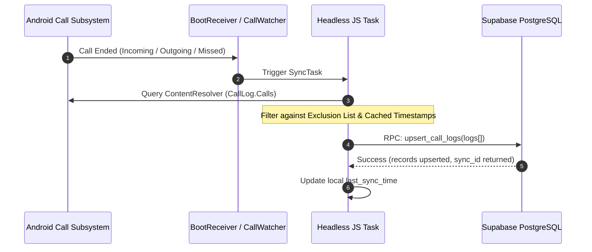

# Architecture & System Design

This document details the architectural principles, component interactions, and data synchronization workflows governing the **TeleCallerTracker** platform.

---

## 1. System Topology

```mermaid
flowchart TD
    subgraph Client Layer
        M[Android Telephony Manager] -->|Raw Call Broadcast| CR[Boot & Call Broadcast Receivers]
        CR --> BS[SyncService / Headless JS]
        BS --> LocalStorage[(AsyncStorage / Encrypted Prefs)]
        UI[React Native UI] --> LocalStorage
    end

    subgraph Transport
        BS -->|HTTPS Batch Upsert (Bearer JWT)| Gateway[Supabase API Gateway / Kong]
    end

    subgraph Data & Storage Layer
        Gateway --> PG[(PostgreSQL with PostGIS / pg_cron)]
        PG --> RLS[Row Level Security Enforcement]
        RLS --> Tables[(Core Multi-Tenant Tables)]
    end

    subgraph Management Layer
        Web[Next.js 14 Web Portal] -->|Server Components & Server Actions| PG
        Web --> Session[HTTP-Only Cookie Session]
        Session --> Auth[Supabase GoTrue Auth]
    end
```

---

## 2. Multi-Tenant Isolation Architecture

The platform provides complete multi-tenancy at the relational level using PostgreSQL Row-Level Security (RLS). Every tenant belongs to an `organisations` record:

1. **Tenant Anchor:** Every core table (`callers`, `call_logs`, `sync_logs`, `leads`, `pinned_call_logs`, `excluded_numbers`, `note_templates`, `message_templates`, `connector_configs`) carries a foreign key:
   ```sql
   org_id uuid NOT NULL REFERENCES organisations(id) ON DELETE CASCADE
   ```
2. **Session Context:** When requests arrive through the Next.js portal or mobile app, the user's authenticated `auth.uid()` is resolved through the `org_members` junction table:
   ```sql
   CREATE FUNCTION public.get_user_org_id() RETURNS uuid AS $$
     SELECT org_id FROM public.org_members WHERE user_id = auth.uid() LIMIT 1;
   $$ LANGUAGE sql SECURITY DEFINER STABLE;
   ```
3. **Transparent Policy Enforcement:** All `SELECT`, `INSERT`, `UPDATE`, and `DELETE` queries automatically filter against `org_id = public.get_user_org_id()`. Users can never query or mutate data belonging to another organisation, even if IDs are known.

---

## 3. Mobile Synchronization Pipeline

The mobile client is engineered to handle unreliable mobile network conditions, device reboots, and high call volumes without data loss or duplicates.



### Call Deduplication & Idempotency
- **Unique Deterministic Hash:** Every call event is hashed using `(caller_id, phone_number, called_at, duration)` to produce a deterministic idempotency key.
- **Conflict Handling:** The `upsert_call_logs` RPC uses `ON CONFLICT (org_id, caller_id, called_at) DO UPDATE SET duration = EXCLUDED.duration, status = EXCLUDED.status`, ensuring duplicate broadcasts or re-runs never create redundant log rows.
- **Exclusion Scrubbing:** Any phone number matching the tenant's `excluded_numbers` registry is scrubbed on device before transmission, protecting executive privacy.

---

## 4. Web Portal Architectural Pattern

The web portal is built on Next.js 14 utilizing React Server Components (RSC) and Server Actions:

* **Zero-Waterfall Server Components:** Pages like `/dashboard` and `/reports` execute database RPC queries server-side in parallel. No client-side waterfall spinners.
* **Server Actions for State Mutation:** Mutations (adding managers, creating note templates, tagging leads, regenerating invite codes) execute via Next.js Server Actions with built-in CSRF protection and automatic path revalidation (`revalidatePath`).
* **Route Protection Middleware:** [`middleware.ts`](../portal/middleware.ts) validates session JWTs before request headers hit page renderers. Expired sessions are refreshed transparently, and unauthenticated visitors are redirected to `/login`.

---

## 5. Security & Cryptographic Standards

* **Credential Storage:** Mobile tokens and org invite codes are stored using Android Keystore / encrypted shared preferences.
* **Connector Secrets Encryption:** Third-party connector configurations (CRM webhooks, Twilio tokens) are encrypted at rest using AES-256-GCM via `CONNECTOR_ENCRYPTION_KEY`.
* **Least Privilege:** Supabase Service Role keys are restricted strictly to server-side administrative tasks (such as provisioning manager auth accounts) and are never exposed in browser bundles.
