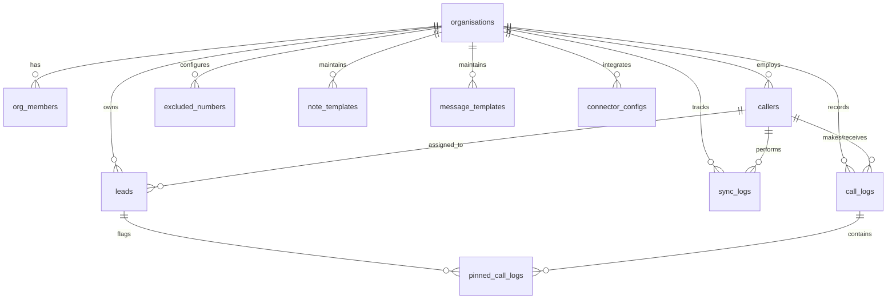

# Database Schema & Data Dictionary

This document serves as the comprehensive reference for the PostgreSQL relational schema utilized by **TeleCallerTracker**.

---

## 1. Entity-Relationship Diagram (ERD)



---

## 2. Enumerated Types

```sql
CREATE TYPE org_role AS ENUM ('owner', 'admin', 'member');
CREATE TYPE call_type AS ENUM ('incoming', 'outgoing', 'missed', 'rejected');
CREATE TYPE lead_status AS ENUM ('new', 'contacted', 'interested', 'not_interested', 'follow_up', 'converted', 'closed');
CREATE TYPE connector_type AS ENUM ('webhook', 'crm', 'sheet', 'custom');
```

---

## 3. Core Tables

### `organisations`
Stores business accounts (tenants).
| Column | Type | Constraints | Description |
| :--- | :--- | :--- | :--- |
| `id` | `uuid` | `PRIMARY KEY DEFAULT gen_random_uuid()` | Unique organisation identifier |
| `name` | `text` | `NOT NULL` | Company / Team display name |
| `invite_code` | `char(8)` | `NOT NULL UNIQUE` | Alphanumeric registration token for mobile onboarding |
| `deleted_at` | `timestamptz` | `NULL` | Soft deletion timestamp |
| `created_at` | `timestamptz` | `DEFAULT now() NOT NULL` | Creation timestamp |

---

### `org_members`
Portal administrators and managers.
| Column | Type | Constraints | Description |
| :--- | :--- | :--- | :--- |
| `id` | `uuid` | `PRIMARY KEY DEFAULT gen_random_uuid()` | Record ID |
| `org_id` | `uuid` | `REFERENCES organisations(id) ON DELETE CASCADE` | Associated tenant |
| `user_id` | `uuid` | `REFERENCES auth.users(id) ON DELETE CASCADE` | Supabase Auth user ID |
| `role` | `org_role` | `DEFAULT 'member' NOT NULL` | User role (`owner`, `admin`, `member`) |
| `created_at` | `timestamptz` | `DEFAULT now() NOT NULL` | Member joining date |

---

### `callers`
Telecallers operating the mobile app.
| Column | Type | Constraints | Description |
| :--- | :--- | :--- | :--- |
| `id` | `uuid` | `PRIMARY KEY DEFAULT gen_random_uuid()` | Telecaller unique ID |
| `org_id` | `uuid` | `REFERENCES organisations(id) ON DELETE CASCADE` | Associated tenant |
| `name` | `text` | `NOT NULL` | Agent name |
| `phone_number` | `text` | `NOT NULL` | Agent SIM/device phone number |
| `device_id` | `text` | `NULL` | Hardware fingerprint |
| `is_active` | `boolean` | `DEFAULT true NOT NULL` | Active status |
| `created_at` | `timestamptz` | `DEFAULT now() NOT NULL` | Enrollment date |

---

### `call_logs`
Chronological call activity synced from telecaller devices.
| Column | Type | Constraints | Description |
| :--- | :--- | :--- | :--- |
| `id` | `uuid` | `PRIMARY KEY DEFAULT gen_random_uuid()` | Log event ID |
| `org_id` | `uuid` | `REFERENCES organisations(id) ON DELETE CASCADE` | Associated tenant |
| `caller_id` | `uuid` | `REFERENCES callers(id) ON DELETE CASCADE` | Telecaller agent |
| `contact_number`| `text` | `NOT NULL` | External customer phone number |
| `contact_name` | `text` | `NULL` | Name associated in contact book |
| `type` | `call_type` | `NOT NULL` | `incoming`, `outgoing`, `missed`, `rejected` |
| `duration` | `integer` | `DEFAULT 0 NOT NULL` | Call length in seconds |
| `called_at` | `timestamptz` | `NOT NULL` | Timestamp recorded on device |
| `recording_url`| `text` | `NULL` | Cloud storage recording pointer |
| `notes` | `text` | `NULL` | Agent disposition notes |
| `created_at` | `timestamptz` | `DEFAULT now() NOT NULL` | Synced timestamp |

---

### `leads`
Lead pipeline and CRM records.
| Column | Type | Constraints | Description |
| :--- | :--- | :--- | :--- |
| `id` | `uuid` | `PRIMARY KEY DEFAULT gen_random_uuid()` | Lead ID |
| `org_id` | `uuid` | `REFERENCES organisations(id) ON DELETE CASCADE` | Associated tenant |
| `name` | `text` | `NOT NULL` | Lead name |
| `phone_number` | `text` | `NOT NULL` | Primary contact number |
| `status` | `lead_status`| `DEFAULT 'new' NOT NULL` | Pipeline status stage |
| `assigned_to` | `uuid` | `REFERENCES callers(id) ON DELETE SET NULL` | Assigned agent |
| `notes` | `text` | `NULL` | Cumulative CRM notes |
| `last_called_at`|`timestamptz`| `NULL` | Most recent interaction timestamp |
| `created_at` | `timestamptz` | `DEFAULT now() NOT NULL` | Lead creation date |

---

### Auxiliary Tables
* `excluded_numbers`: Numbers scrubbed before call logs are processed (`org_id`, `phone_number`).
* `note_templates`: Pre-made call note templates for agents (`org_id`, `title`, `content`).
* `message_templates`: SMS/WhatsApp messaging shortcuts (`org_id`, `title`, `content`).
* `pinned_call_logs`: Flagged logs for quality review (`org_id`, `call_log_id`, `pinned_by`, `reason`).
* `connector_configs`: Third-party integration configurations (`org_id`, `connector_type`, `config_data`).

---

## 4. Key Performance Indexes

```sql
CREATE INDEX idx_call_logs_org_caller_date ON call_logs (org_id, caller_id, called_at DESC);
CREATE INDEX idx_call_logs_contact_number  ON call_logs (org_id, contact_number);
CREATE INDEX idx_leads_org_status          ON leads (org_id, status);
CREATE INDEX idx_leads_assigned_to         ON leads (org_id, assigned_to);
CREATE INDEX idx_organisations_invite_code ON organisations (invite_code) WHERE deleted_at IS NULL;
CREATE INDEX idx_excluded_numbers_org      ON excluded_numbers (org_id, phone_number);
```

---

## 5. Stored Procedures & RPCs

### `get_employee_report(p_org_id, p_start_date, p_end_date)`
Returns aggregated performance metrics per telecaller over a given date range:
* `total_calls`: Total initiated and received calls.
* `connected_calls`: Calls where `duration > 0`.
* `talk_time`: Total talk time in seconds.
* `avg_duration`: Average talk duration in seconds.
* `working_hours`: Calculated active hours from daily first call to last call.

### `upsert_call_logs(p_logs jsonb)`
Batch imports call records from mobile clients with conflict resolution:
* Validates `org_id` and `caller_id`.
* Excludes numbers listed in `excluded_numbers`.
* Performs upsert on conflict: updates duration, disposition, or notes if a log entry was updated locally.

### `get_call_type_distribution(p_org_id, p_start_date, p_end_date)`
Rolls up call counts by `incoming`, `outgoing`, `missed`, and `rejected` for pie chart rendering.
